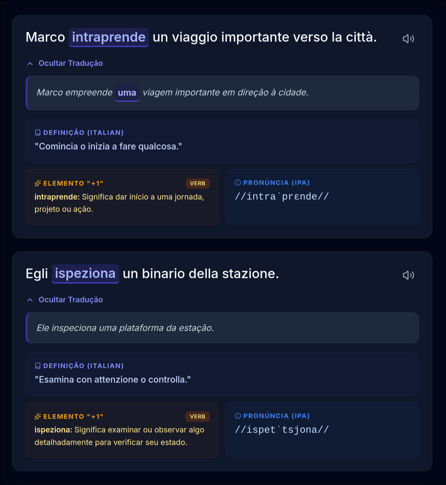

# Polyglot i+1 — AI-Powered Natural Language Learning

**Open-source comprehensible-input language learning app: AI-generated i+1 stories, contextual vocabulary, audio, and FSRS spaced repetition.**

[](LICENSE.md)
[](package.json)
[](package.json)
[](https://aistudio.google.com/apikey)

[Live App](https://polyglotai.ai.studio/) · [Features](#-features) · [Install](#-getting-started) · [Why Polyglot](#-the-i1-principle) · [Contributing](CONTRIBUTING.md)

Polyglot i+1 is an AI-powered language learning application built around the **Natural Method**, **comprehensible input**, and Stephen Krashen's ***i+1* principle**: learners acquire language by understanding content that is mostly familiar while encountering a small amount of new vocabulary — the same idea behind graded readers.

Instead of relying exclusively on isolated word lists, Polyglot generates personalized stories based on your current proficiency level and known vocabulary. Each lesson introduces new linguistic elements in context, helping you build comprehension, vocabulary, and familiarity with the target language.

<p align="center">
  
</p>

## ✨ Features

### 📖 Personalized AI-Generated Stories

- Generate original stories tailored to your language level and vocabulary.
- Follow the *i+1 principle*, introducing new elements within familiar contexts.
- Choose between multiple story lengths.
- Receive sentence translations, vocabulary explanations, and phonetic information.
- Review previously completed stories without disrupting your learning progress.

### 🧠 Natural Learning Through Context

- Maintain a personalized vocabulary of known words.
- Adapt new stories to your existing vocabulary.
- Introduce unfamiliar words and expressions in meaningful contexts.
- Generate review stories focused on consolidating vocabulary you already know.
- Explore new vocabulary through contextual definitions and translations.

### 🔊 Audio and Pronunciation

- Listen to individual sentences.
- Generate audio narration for complete stories.
- Download story audio in WAV format.
- Use browser-based speech synthesis as a fallback for sentence pronunciation.
- Explore IPA phonetic transcriptions for newly introduced elements when provided.

### 🔁 Spaced Repetition System

Polyglot includes a flashcard-based review system inspired by Anki, scheduled with the FSRS-5 spaced repetition algorithm.

- Per-card stability, difficulty, and retrievability modeling with a configurable target retention (80%–97%).

- Automatically create review cards from completed lessons.
- Review new, learning, due, and mastered cards.
- Rate recall difficulty using **Again**, **Hard**, **Good**, and **Easy**.
- Choose how answers appear on flashcards:
  - Full sentence translation.
  - Translation of the new linguistic element.
  - Definition in the target language.
- Track review statistics and reinforce vocabulary over time.

### 📊 Progress Tracking

- Track completed lessons and vocabulary growth.
- Review your learning history and revisit previous stories.
- Visualize vocabulary growth over time.
- Monitor study streaks and daily learning goals.
- Configure your preferred lesson size and study settings.

### 🌍 Language and Learning Preferences

Configure your target language, native language, proficiency level, and interface preferences.

**Available target languages and varieties include:**

- English
- Shakespearean English
- Spanish
- French
- German
- Italian
- Portuguese
- Japanese
- Chinese
- Russian
- Latin
- Modern Greek
- Ancient Greek

CEFR proficiency levels range from **A1 to C2**.

Specialized options are available for Ancient Greek, including Attic and Koine dialects, and for Shakespearean English, including dramatic and courtly styles.

The interface is available in English, Portuguese, Spanish, French, German, and Italian.

### 💾 Local Data and Portable Backups

- Save your learning profile, known vocabulary, lesson history, and review progress locally.
- Export your data as a JSON backup.
- Import a previous backup to restore your progress.
- Transfer your learning data between devices by exporting and importing a backup.

Your learning data is designed to remain under your local control rather than relying on a mandatory cloud account.

---

## 🧭 The i+1 Principle

The core idea behind Polyglot is simple:

- **i** represents what you can already understand.
- **+1** represents a small amount of new language introduced within that familiar context.

A learner who understands most of a story can use context to infer unfamiliar words and expressions. Polyglot uses your known vocabulary and selected proficiency level to guide AI-generated lessons toward this approach.

The goal is to make language learning more contextual, personalized, and sustainable.

> Learn through comprehension. Build vocabulary through context. Reinforce what matters through repetition.

## 🚀 Getting Started

### Prerequisites

- [Node.js](https://nodejs.org/) and npm.
- A Google Gemini API key from [Google AI Studio](https://aistudio.google.com/apikey).

### Installation

Clone the repository:

```bash
git clone https://github.com/ludoviciphilip/Polyglot-AI.git
cd Polyglot-AI
```

Install dependencies:

```bash
npm install
```

Start the development server:

```bash
npm run dev
```

Open the local URL displayed by Vite in your terminal.

### Configure Gemini

1. Open the application.
2. Navigate to **Settings**.
3. Obtain an API key through [Google AI Studio](https://aistudio.google.com/apikey).
4. Enter and save your Gemini API key.
5. Configure your target language, native language, CEFR level, and known vocabulary.
6. Generate your first lesson.

The application uses Google's Gemini API to generate personalized stories and vocabulary review material. Story audio generation also uses Gemini when available.

**API usage:** Requests to Gemini are subject to Google's model availability, quotas, and applicable pricing. Check the current terms for your account before relying on a particular usage limit.

## 🛠️ Development

This project uses a modern TypeScript and React frontend.

| Technology | Purpose |
|---|---|
| React 19 | User interface |
| TypeScript | Type safety |
| Vite | Development server and production builds |
| Google GenAI SDK | AI-powered story generation and audio |
| Recharts | Progress visualization |
| Lucide React | Interface icons |

### Available Scripts

```bash
npm run dev      # Start the development server
npm run build    # Create a production build
npm run preview  # Preview the production build
npm run lint     # Run the TypeScript compiler checks
```

### Project Structure

```text
Polyglot-AI/
├── components/
│   ├── Dashboard.tsx
│   ├── StudyArea.tsx
│   ├── History.tsx
│   ├── Settings.tsx
│   ├── SRSReviewArea.tsx
│   ├── VocabularyModal.tsx
│   └── ...
├── services/
│   └── geminiService.ts
├── utils/
├── migrated_prompt_history/
├── App.tsx
├── index.tsx
├── types.ts
├── index.html
├── package.json
├── tsconfig.json
└── vite.config.ts
```

- **`App.tsx`** coordinates the main application, profile, lessons, history, and review workflow.
- **`components/`** contains the dashboard, study interface, settings, vocabulary tools, and spaced repetition experience.
- **`services/geminiService.ts`** handles AI-powered story generation and vocabulary review generation.
- **`utils/`** contains supporting utilities.
- **`types.ts`** defines the application's core data structures, user profile, lesson format, and review cards.

## 🔐 Privacy and Security

Polyglot is designed around local learning data and user-controlled backups.

- Learning preferences, vocabulary, and history are stored in browser-local storage.
- The Gemini API key can be saved locally and is included in exported JSON backups.
- AI features send requests to Google's Gemini API.

**Important security considerations:**

- Treat exported JSON backups as sensitive because they may contain your API key and personal learning data.
- Do not commit API keys to source control or share them publicly.
- Because the application calls Gemini from the browser, a key entered by a user should be treated as accessible to that browser environment. Local storage is not a secure secret vault.

## 🔄 Alternatives / Comparison

Polyglot i+1 sits at the intersection of a few categories of language-learning tools:

- **Like Anki**, it uses flashcards and a spaced-repetition scheduler (FSRS-5) — but cards are generated automatically from stories you've read instead of being authored by hand.
- **Like LingQ or Readlang**, it's built around reading comprehensible content and looking up unfamiliar words in context — but the reading material itself is generated for your vocabulary level by AI rather than imported from existing texts.
- **Unlike most commercial apps**, it has no mandatory account or cloud sync: your profile, vocabulary, and review history live in your browser and move between devices only via manual JSON export/import.

Anki, LingQ, and Readlang are trademarks of their respective owners; Polyglot i+1 is not affiliated with, sponsored by, or endorsed by any of them. Google Gemini is a trademark of Google LLC; Polyglot i+1 uses the public Gemini API as an AI provider and is not affiliated with Google.

## 🗺️ Project Status

Polyglot i+1 is an evolving project focused on contextual language acquisition, personalized learning, and long-term vocabulary retention.

AI-generated content may contain translation, grammar, pronunciation, or factual errors. Learners should use generated material as a study aid rather than as an infallible linguistic reference.

## 🤝 Contributing

Contributions, bug reports, feature suggestions, and ideas for improving the learning experience are welcome.

1. Fork the repository.
2. Create a feature branch.
3. Make your changes.
4. Run the available checks and production build.
5. Submit a pull request describing the changes.

For substantial changes, consider opening an issue first to discuss the proposed approach.

## 📄 License

See [`LICENSE.md`](LICENSE.md) for the project's license and applicable terms.

---

**Polyglot i+1 — Make every story a step toward fluency.**
